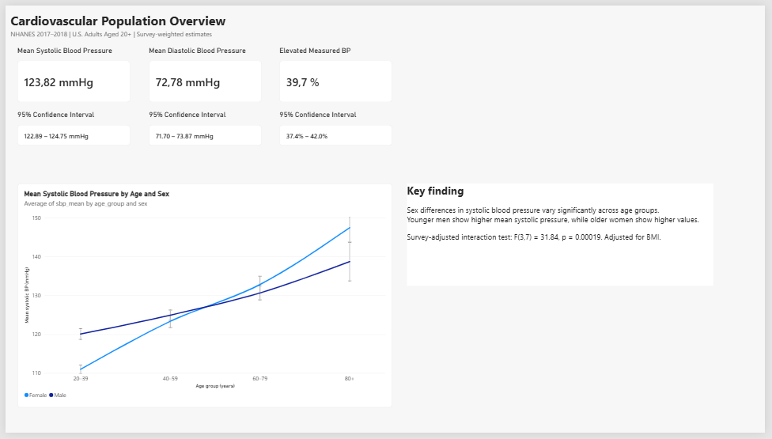
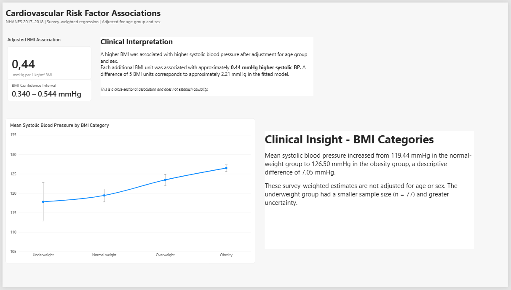
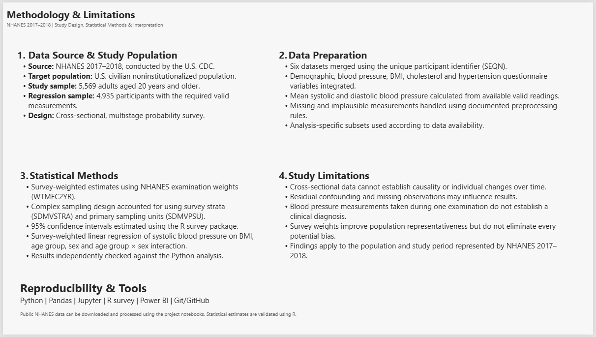

# Cardiovascular Risk & Clinical Insights

**Survey-weighted cardiovascular analysis of NHANES 2017–2018 | Python · R · Power BI**

An end-to-end biomedical data analytics project exploring how systolic blood pressure varies across age, sex, and body mass index (BMI) in U.S. adults. The project combines reproducible data preparation, exploratory analysis, complex-survey statistical modeling, independent implementation cross-checks, and a three-page Power BI report.

> **Scope:** Observational, cross-sectional research using public-use data. Findings are associations, not causal effects or individual medical advice.

## Research questions

1. How does mean systolic blood pressure differ across age groups and sex?
2. Is BMI associated with systolic blood pressure after adjusting for age group and sex?
3. How does mean systolic blood pressure vary across adult BMI categories?
4. What proportion of adults have elevated *measured* blood pressure according to a clearly defined descriptive threshold?

## Key findings

| Result | Estimate | Interpretation |
| --- | ---: | --- |
| Survey-weighted mean systolic BP | **123.82 mmHg** | 95% CI: 122.89–124.75 |
| Survey-weighted mean diastolic BP | **72.78 mmHg** | 95% CI: 71.70–73.87 |
| Elevated measured BP | **39.7%** | 95% CI: 37.4–42.0%; mean SBP ≥130 or mean DBP ≥80 mmHg, with both measurements available |
| Adjusted BMI coefficient | **+0.442 mmHg per 1 kg/m² BMI** | 95% CI: 0.340–0.544; model includes age group, sex and their interaction |
| Age-group × sex interaction | **F(3, 7) = 31.84; p = 0.000188** | Survey-adjusted joint Wald test; evidence that sex differences in systolic BP vary across age groups |

The age/sex pattern reverses across the studied groups: survey-weighted mean systolic BP is higher among men at ages 20–39 (120.05 vs 110.99 mmHg), while women have higher means at age 80+ (147.42 vs 138.68 mmHg). These are **comparisons between different participants at one point in time**, not changes within individuals as they age.

### BMI category analysis

| BMI category | Sample size (unweighted) | Mean systolic BP, mmHg | 95% CI, mmHg |
| --- | ---: | ---: | --- |
| Underweight (<18.5) | 77 | 117.82 | 112.84–122.80 |
| Normal weight (18.5–<25) | 1,208 | 119.44 | 117.79–121.10 |
| Overweight (25–<30) | 1,579 | 123.45 | 122.03–124.88 |
| Obesity (≥30) | 2,071 | 126.50 | 125.66–127.34 |

These are **survey-weighted but unadjusted** group means. The obesity versus normal-weight difference is approximately **7.05 mmHg descriptively**; it is not a causal effect or an age-/sex-adjusted contrast. The underweight group is small and has greater uncertainty.

## Dashboard preview

### 1. Population overview



### 2. Cardiovascular risk factor associations



### 3. Methodology and limitations



Open [`dashboard/cardiovascular_insights.pbix`](dashboard/cardiovascular_insights.pbix) in **Power BI Desktop** to explore the report. The file uses locally generated public-use NHANES-derived tables; data refresh may require updating CSV paths for your computer.

## Data and study population

- **Source:** [CDC NHANES 2017–2018](https://wwwn.cdc.gov/nchs/nhanes/search/DataPage.aspx?Cycle=2017-2018).
- **Population represented:** U.S. civilian, noninstitutionalized population (with analysis restricted to adults aged 20+).
- **Adult sample prepared:** 5,569 participants.
- **Regression analytical sample:** 4,935 participants with nonmissing required variables.
- **NHANES component files:** `DEMO_J`, `BPX_J`, `BMX_J`, `TCHOL_J`, `HDL_J`, `BPQ_J`.
- **Linkage:** Unique public-use participant ID `SEQN`.
- **Core variables:** Age, sex, mean systolic/diastolic BP, BMI, total cholesterol, HDL cholesterol, hypertension questionnaire responses.

## Methods

1. **Data preparation (Python).** Download and merge NHANES tables, restrict the analysis to adults aged 20+, calculate mean BP from readings retained under documented plausibility rules, handle missing questionnaire values explicitly, and export a reusable analysis table.
2. **Exploratory data analysis (Python).** Characterize variable distributions and visualize BP associations with demographic and metabolic variables. These descriptive EDA plots are not population-level inferential tests.
3. **Complex-survey statistics (Python and R).** Use NHANES MEC examination weights (`WTMEC2YR`), survey strata (`SDMVSTRA`) and primary sampling units (`SDMVPSU`). Produce survey-weighted estimates and confidence intervals, and fit a survey-weighted linear regression with an age group × sex interaction using the R `survey` package.
4. **Validation.** Cross-check point estimates across Python and R. Use R `survey` output for reported confidence intervals and the joint interaction Wald test, including its survey-design degrees of freedom.
5. **Communication (Power BI).** Present validated aggregate estimates, uncertainty, clinical interpretation and study limitations.

**Definition:** *Elevated measured BP* is mean SBP ≥130 mmHg **or** mean DBP ≥80 mmHg, when both average measurements are available. This is a descriptive, single-examination indicator, **not diagnosed hypertension**.

## Repository structure

```text
cardiovascular-nhanes/
├── README.md
├── requirements.txt
├── .gitignore
├── notebooks/
│   ├── 00_environment_test.ipynb
│   ├── 01_data_preparation.ipynb
│   ├── 02_exploratory_analysis.ipynb
│   └── 03_statistical_analysis.ipynb
├── scripts/
│   ├── 04_validate_survey_models.R
│   └── 05_bmi_category_analysis.R
├── dashboard/
│   └── cardiovascular_insights.pbix
├── docs/
│   └── screenshots/
│       ├── population_overview.png
│       ├── risk_factor_associations.png
│       └── methodology_limitations.png
├── reports/
│   └── figures/
└── data/
    ├── raw/           # Local NHANES XPT files (not tracked)
    └── processed/     # Local generated CSVs (not tracked)
```

## Reproduce the analysis

**Requirements:** Python 3.12 (or a compatible 3.x environment), Jupyter / VS Code, R with the `survey` package, and Power BI Desktop for the dashboard.

1. Clone the repository and open it in VS Code:
   ```powershell
   git clone https://github.com/rolalla/cardiovascular-nhanes.git
   cd cardiovascular-nhanes
   ```
2. Create and activate a Python virtual environment, then install dependencies:
   ```powershell
   python -m venv .venv
   .\.venv\Scripts\Activate.ps1
   python -m pip install -r requirements.txt
   ```
3. In VS Code, select `.venv` as the notebook kernel. Run `notebooks/01_data_preparation.ipynb`, then `02_exploratory_analysis.ipynb`, then `03_statistical_analysis.ipynb`, in that order. Run them from the `notebooks/` folder or project root as supported by the notebook path setup.
4. NHANES `.XPT` input files can be downloaded automatically by the preparation notebook. If the CDC endpoint is unavailable, manually download the six named source files and place them in `data/raw/`.
5. Install the R `survey` package in a writable R library, then run the following **from the project root**:
   ```powershell
   Rscript scripts/04_validate_survey_models.R
   Rscript scripts/05_bmi_category_analysis.R
   ```
   On some Windows systems, R may need `R_LIBS_USER` configured to point to a personal package library.
6. Open `dashboard/cardiovascular_insights.pbix`. If Power BI cannot find the locally generated CSVs, use **Transform Data → Data source settings** to update their file paths and refresh the report.

The key files exported by the R scripts into `data/processed/` include `r_validated_overall.csv`, `r_validated_groups.csv`, `r_validated_interaction_model.csv` and `r_validated_bmi_groups.csv`. They are intentionally excluded from Git because they can be regenerated.

## Limitations

- **Cross-sectional design:** age-group differences are not longitudinal trajectories; associations do not imply causality.
- **Confounding:** the adjusted model accounts for BMI, age group, sex and an age-by-sex interaction, but other clinical and behavioral confounders may remain.
- **Measurement:** blood pressure was measured during a single examination; the descriptive elevated-BP indicator should not be confused with clinical hypertension prevalence.
- **Missingness and cohort restrictions:** effective sample sizes differ by outcome and analysis; results may be sensitive to exclusions and preprocessing choices.
- **Design and generalizability:** survey-weighted estimates target the population represented by NHANES 2017–2018, not present-day populations or other countries.
- **Small subgroups:** the underweight BMI category (n=77) has substantially wider uncertainty.

## Tools

**Python:** Pandas, NumPy, SciPy, Statsmodels, Matplotlib, Seaborn, Jupyter  
**R:** `survey` for complex-survey design analysis and regression inference  
**Visualization:** Microsoft Power BI Desktop  
**Version control:** Git and GitHub

## Acknowledgment

Data source: Centers for Disease Control and Prevention (CDC), National Center for Health Statistics, NHANES 2017–2018. This is an independent educational portfolio project; it is not affiliated with or endorsed by the CDC or Novo Nordisk.
